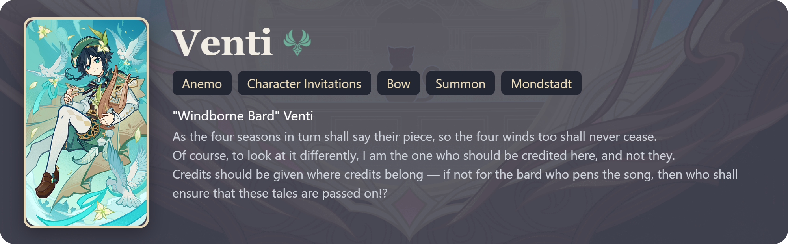
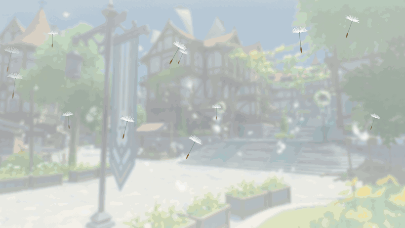
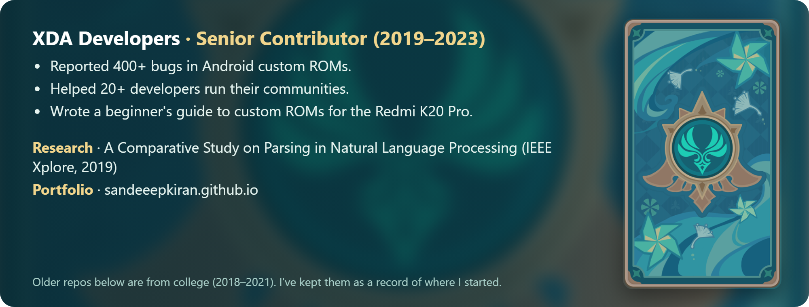

<!-- Images come from the "output" branch, redrawn daily by .github/workflows/profile-cards.yml.
     Decoration style: edit effects.txt (ai-drawn | fanart | off). -->

  <picture>
    <source media="(prefers-color-scheme: dark)" srcset="https://raw.githubusercontent.com/SandeeepKiran/SandeeepKiran/output/banner-dark.svg">
    
  </picture>

  <picture>
    <source media="(prefers-color-scheme: dark)" srcset="https://raw.githubusercontent.com/SandeeepKiran/SandeeepKiran/output/typing-dark.svg">
    
  </picture>

📍 Bengaluru, India &nbsp;·&nbsp; US Citizen &nbsp;·&nbsp; Indian OCI

  
  
  
  
  

> [!TIP]
> A genius known as the Kreideprinz, he is the Chief Alchemist and Captain of the Investigation Team of the Knights of Favonius.
>
> 

  

<picture>
  <source media="(prefers-color-scheme: dark)" srcset="https://raw.githubusercontent.com/SandeeepKiran/SandeeepKiran/output/divider-dark.svg">
  
</picture>

## <picture><source media="(prefers-color-scheme: dark)" srcset="assets/icons/what-i-do-dark.png"></picture> What I do

- **Lead QA** for a conversational AI platform: test strategy, release sign-off and a team of QA engineers.
- **Build AI-driven QA:** LLM tester agents that talk to voice assistants, and LLM-as-judge scoring for every conversation.
- **Ship side projects** I want to use myself, and test them like I test at work.

## <picture><source media="(prefers-color-scheme: dark)" srcset="assets/icons/skills-dark.png"></picture> Skills

### <picture><source media="(prefers-color-scheme: dark)" srcset="assets/icons/ai-dark.png"></picture> AI & LLMs

         

### <picture><source media="(prefers-color-scheme: dark)" srcset="assets/icons/ai-eval-dark.png"></picture> AI Evaluation

       

### <picture><source media="(prefers-color-scheme: dark)" srcset="assets/icons/testing-dark.png"></picture> Testing

          

### <picture><source media="(prefers-color-scheme: dark)" srcset="assets/icons/tech-dark.png"></picture> Tech & Tools

            

### <picture><source media="(prefers-color-scheme: dark)" srcset="assets/icons/domains-dark.png"></picture> Domains

        

<picture>
  <source media="(prefers-color-scheme: dark)" srcset="https://raw.githubusercontent.com/SandeeepKiran/SandeeepKiran/output/divider-dark.svg">
  
</picture>

## <picture><source media="(prefers-color-scheme: dark)" srcset="assets/icons/projects-dark.png"></picture> Projects

| Project | What it is | Stack | Links |
|---|---|---|---|
| **Kitsune Labs** | QA tools in the browser: test generation, bug finding and reports | TypeScript · Vite · LLM APIs |   |
| **Windfall Gallery** | Android gallery that shows your photos and videos in random order | Kotlin · Jetpack Compose · Media3 |   |
| **My Personal UX for Amazon** | Browser extension that cleans up Amazon pages | JavaScript · MV3 · Chrome, Edge, Firefox |   |
| **Leyline Autofill** | AI autofill for job application forms. You review, it never submits | JavaScript · MV3 · GPT and Claude APIs |   |
| **Sandstorm Secure** | Phone security and device management | Python · FastAPI · Android Management API |   |
| **Internal QA Tool** | At work: AI regression platform where LLM testers talk to a bot and get scored | Next.js · TypeScript · Claude API | Private |

<picture>
  <source media="(prefers-color-scheme: dark)" srcset="https://raw.githubusercontent.com/SandeeepKiran/SandeeepKiran/output/divider-dark.svg">
  
</picture>

## <picture><source media="(prefers-color-scheme: dark)" srcset="assets/icons/stats-dark.png"></picture> The Stats

  <picture>
    <source media="(prefers-color-scheme: dark)" srcset="https://raw.githubusercontent.com/SandeeepKiran/SandeeepKiran/output/stats-dark.svg">
    
  </picture>
  <picture>
    <source media="(prefers-color-scheme: dark)" srcset="https://raw.githubusercontent.com/SandeeepKiran/SandeeepKiran/output/activity-dark.svg">
    
  </picture>

  <picture>
    <source media="(prefers-color-scheme: dark)" srcset="https://raw.githubusercontent.com/SandeeepKiran/SandeeepKiran/output/streak-dark.svg">
    
  </picture>

  <picture>
    <source media="(prefers-color-scheme: dark)" srcset="https://raw.githubusercontent.com/SandeeepKiran/SandeeepKiran/output/snake-dark.svg">
    
  </picture>

<picture><source media="(prefers-color-scheme: dark)" srcset="assets/icons/more-dark.png"></picture> <b>More about me</b>

 

  
  
  

